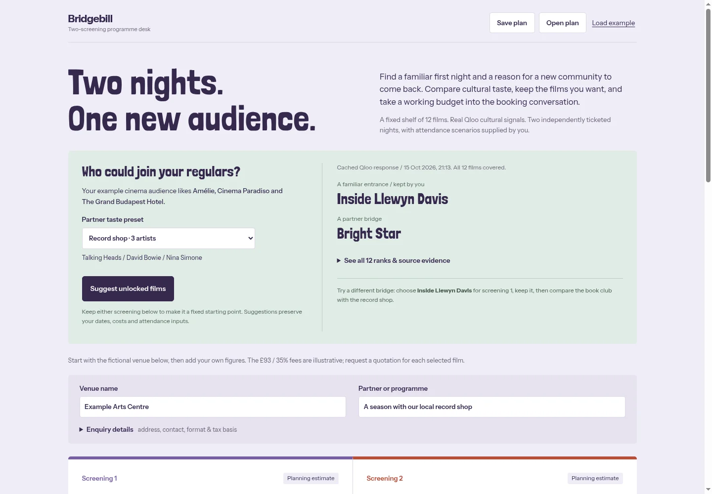

# Bridgebill live programme desk

**[Open Bridgebill](https://blucca.github.io/research/bridgebill/planner/)** · [Direct live service](https://appear-photos-prefix-velvet.trycloudflare.com/) · [Source](https://github.com/blucca/blucca.github.io/tree/main/research/bridgebill)

Bridgebill helps a small mixed-arts venue take two film nights from a cultural hunch to a booking conversation. The venue has an existing cinema audience and a possible book-club or record-shop partner. The assistant compares their declared tastes, preserves a film the programmer wants to keep, calculates two independent screening budgets, and prepares a source-linked booking pack.

## A two-minute walkthrough

1. Open the fictional **Example Arts Centre**. Choose **Book club · 2 books**, then **Suggest unlocked films**. The current default programme is *Before Sunrise* / *Inside Llewyn Davis*.
2. Set screening 1 to **Inside Llewyn Davis**, check **Keep this film**, and suggest again. The book preset selects **Wings of Desire** for screening 2.
3. Change the partner to **Record shop · 3 artists**, then suggest again. Screening 1 stays locked; screening 2 becomes **Bright Star**. Expand **See all 12 ranks & source evidence** to inspect both rank columns, returned affinity values and retrieval times.
4. Change screening 1’s minimum licence to **£500**. Its ticket target changes from **39 to 75**; screening 2 stays at **28**. Dates, attendance scenarios and other budget inputs remain yours. At the starter attendance of 40, screening 1 now loses £350.
5. **Draft programme notes**. The assistant turns the Qloo evidence and booking states into short programme notes, a partner invitation and questions to settle with the distributor and community.
6. **Download enquiry pack** for the two budget cards, sourced distributor routes, two draft enquiries and current AI notes. **Save plan** / **Open plan** preserve the partner, locks, figures and draft. Review and send the messages yourself.

Both presets currently choose the same default pair. The demonstrated change is the locked-first-film fallback above. This walkthrough uses developer-operated fictional venue inputs. Professional venue use is still being sought.



## How Qloo changes the work

`GET /search` resolved title/year/director identities for 12 films and source-linked book/artist anchors. The original input study included three books; Qloo Insights ignored both reviewed editions of *Mrs Dalloway*. That nine-anchor study failed its original completeness gate. The live app explicitly uses **two accepted books**, **three artists**, and **three cinema anchors**.

| Audience | Declared taste inputs |
| --- | --- |
| Existing cinema audience | Amélie; Cinema Paradiso; The Grand Budapest Hotel |
| Book club | White Teeth — Zadie Smith; Norwegian Wood — Haruki Murakami |
| Record shop | Talking Heads; David Bowie; Nina Simone |

The app calls the hackathon Qloo REST API directly. This is the same Insights workflow available through the optional harness; a framework would add little to this small, bounded programme task.

```text
GET https://hackathon.api.qloo.com/v2/insights
X-Api-Key: [server-side key]
filter.type=urn:entity:movie
filter.results.entities=[the 12 reviewed film UUIDs]
signal.interests.entities=[this audience's reviewed UUIDs]
bias.trends=off
take=12
```

The server requires all 12 requested films, unique IDs, finite affinity in [0, 1], `success=true`, and no omitted-anchor warnings. It sorts on actual Qloo affinity and gives equal scores equal ranks. The UI never labels affinity as a ticket-sales probability.

On 16 October, the exact two-book query returned 12 films with no warnings. Its first two films were *Inside Llewyn Davis* (affinity **0.9085**) and *Wings of Desire* (**0.8710**). The record-shop response placed *Inside Llewyn Davis* first (**0.8848**) and *Bright Star* second (**0.8352**). These are returned observations for this shelf and declared inputs, shown to four decimals. Future retrievals can change.

The selection tool in `planner/programme.mjs` chooses the highest-ranked cinema entrance, then the highest-ranked different partner film, respecting either or both user locks. The title shelf is fixed; the operator can also enter a custom title for budgeting, outside the cultural assistant.

## Bounded agent workflow

```text
Declared partner + two screening slots
  → Qloo Insights tool: compare one fixed shelf for two audiences
  → programme tool: select two distinct films, respecting locks
  → budget tool: calculate each screening in integer pence
  → NVIDIA Nemotron: draft rationale and next booking actions from tool evidence
  → local export: source-linked budgets + enquiries + reviewed draft
```

The model receives the selected films, sourced editorial context, Qloo ranks, partner preset and capacity/quote states. It writes the prose. Integer-pence code handles every displayed financial figure; distributor availability and screening rights are recorded by the venue. Changing the films, partner or relevant states marks old programme prose for refresh. No email or booking is sent automatically.

Raw Qloo responses, entity-resolution records, provider receipts and credentials stay on the private server. Qloo results are cached for one day; older usable responses are labelled **last available** when retrieval fails. The UI displays retrieval timestamps. AI prose is cached against the same film/preset/planning-state evidence. The public UI receives only the 12-film comparison and generated draft. Venue names, contact details, dates, monetary inputs and notes remain in browser local storage and downloaded files.

## Run from a clean checkout

Node.js 22+ and Python 3.9+ are sufficient. No npm dependencies or database.

```sh
git clone https://github.com/blucca/blucca.github.io.git
cd blucca.github.io
node research/bridgebill/planner/budget.check.mjs
node research/bridgebill/planner/programme.check.mjs
```

1. Obtain your Qloo hackathon API key and compatible text-model API credentials. Create a private directory **outside this checkout**.
2. Set `QLOO_API_KEY`, then run the existing identity probe:

   ```sh
   python3 research/bridgebill/probe_qloo.py search --out /absolute/private/qloo
   ```

   Inspect each saved Search response against the title/year/director or book author in `coverage-input.json`. Fill the generated `entity-ids.json` template with the reviewed UUIDs. The live server omits `mrs-dalloway`; the historical `insights` / `audit` probe retains the original three-book study for reproducibility.
3. Copy `research/bridgebill/budget.example.json` to two private files for a shared model cap and this app’s cap. Enter your model ID, verified token prices, confirmed credits, chosen spending allowance and future expiry. The example starts disabled. Both caps reserve a conservative full request cost before the provider call; failures retain the reservation. Do not point both settings at the same file.
4. Create a private environment file with these values:

   ```text
   PORT=4327
   QLOO_API_KEY_FILE=/absolute/private/qloo-api-key
   QLOO_ENTITY_IDS=/absolute/private/qloo/entity-ids.json
   BRIDGEBILL_PRIVATE_DIR=/absolute/private/bridgebill-cache
   NEBIUS_API_KEY=[your text-model key]
   NEBIUS_MODEL=nvidia/nemotron-3-super-120b-a12b
   NEBIUS_BASE_URL=https://api.tokenfactory.us-central1.nebius.com/v1
   NEBIUS_BUDGET_FILE=/absolute/private/shared-budget.json
   BRIDGEBILL_BUDGET_FILE=/absolute/private/project-budget.json
   NEBIUS_BUDGET_RUNTIME_DIR=/absolute/private/budget-staging
   ```

5. Run:

   ```sh
   node --env-file=/absolute/private/bridgebill.env research/bridgebill/server.mjs
   # Open http://127.0.0.1:4327/
   ```

   Set your normal proxy configuration if required by your network. Deploy behind HTTPS for public use. `planner/service.json` points the GitHub Pages frontend to the deployed API; local hosting uses same-origin `/api/` routes. The server only serves the app’s public paths. Its private directory must stay outside the website root.

For the independent budget-only worksheet, `python3 -m http.server 8139` from the repository root remains sufficient; open `/research/bridgebill/planner/`. The core worksheet survives a Qloo/model service outage.

## Scope and evidence

- A fixed 12-title UK-oriented research shelf and two preset partners; custom audience search and distributor live inventory are outside this version.
- Sources and edition/rights-referral notes are in [coverage-input.json](coverage-input.json). Quotes, dates, tax/receipt bases and screening licences come from the distributor. The £93 / 35% example is an illustrative tariff structure, not a quote for the selected films.
- Qloo describes cultural alignment for declared anchors. A venue supplies ticket scenarios and confirms demand with its community. The language-model draft is reviewed by the programmer.
- Acceptance on 16 October: genuine locked-film switch; first quote 39 → 75 with second target 28; JSON save/open/reload including locks/preset/model notes; two-enquiry HTML export; desktop 1440 px and mobile 390 px without horizontal overflow or page errors.
- Built during the hackathon period by Codex / GPT-6 Astra for Blucca. The AI agent performed research, implementation, tool use, testing and submission preparation; the human entrant owns the account and handles eligibility and prize paperwork. NVIDIA Nemotron writes in-app programme prose. The API and model calls in the demo are real, with labelled cache reuse.

## Licence

Original research/worksheet assets retain their stated CC0 1.0 dedication. The live server, programme integration and adapted `credit-budget.mjs` use the repository’s [MIT licence](../../LICENSE). Londrina Solid and Instrument Sans retain their bundled SIL Open Font Licences. Source-linked film/catalogue material and Qloo data retain their providers’ respective terms. Qloo raw responses are excluded from this public repository.
