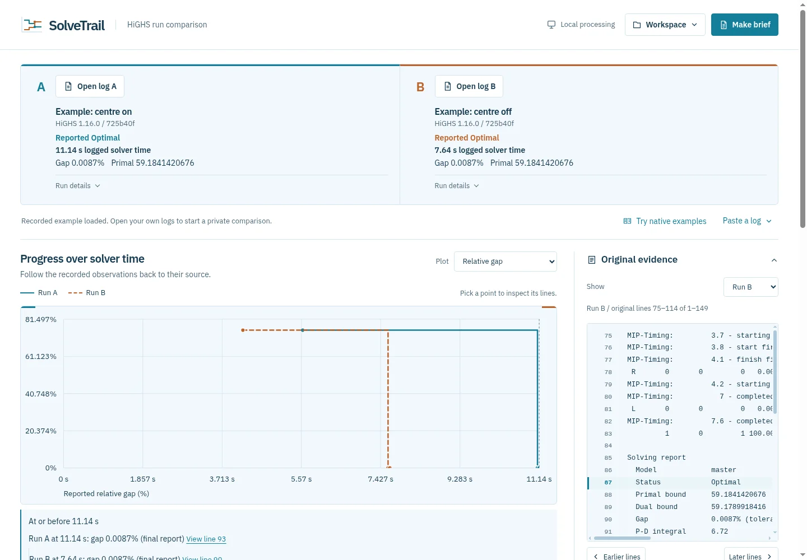

# SolveTrail

**Open two original HiGHS logs. Keep a private, source-backed comparison.**

[Use the complete workbench](https://blucca.github.io/solve-trail/) · [Download the standalone offline app](https://blucca.github.io/solve-trail/solve-trail-offline.zip) · [Watch the 1:43 walkthrough](https://blucca.github.io/solve-trail/demo.html) · [YouTube](https://www.youtube.com/watch?v=ArSGB8pJKfw)

No installation or account. Your log contents stay in the browser. The app makes no network requests with your data and uses no analytics, local-storage tracking or LLM calls.

## One complete comparison

1. **Open log A and log B**, or paste the original output. For an appended file, select the run you want.
2. Read the solver's **final status, gap, primal/dual values and phase times**. Scrub the step plot or select a value to open its original source lines.
3. Declare the **model relationship, shared hardware/resource budget and intended change**. Timing differences describe this recorded pair.
4. **Save workspace** to keep both raw logs, the selected runs and your notes in a private JSON file. Restore it here or in the offline app for the next change.
5. **Make brief** creates editable Markdown with selected parsed facts and source-line references. It omits raw logs, file names and model paths; review your own notes before sharing it.

On phones, selecting a source link takes you to the highlighted original lines. The raw viewer renders a small line window while retaining the full input locally.

## What the evidence says

- **Reported solver time** is HiGHS's native final timing. Whole-process wall time, model construction and external checks belong to their own measurements.
- **Optimal** retains the printed gap and tolerance. The solver report is the input to this workbench; application acceptance uses the original model and a checked solution witness.
- A cut-off log keeps its last observed progress with **no final report**. Missing and infinite values retain their printed meaning.
- Step curves hold recorded samples. First-recorded feasible values and last recorded changes use **log sampling times**.
- The final Presolve / Solve / Postsolve split is kept separate from nested sub-MIP and multi-thread profiling.
- Model identity, hardware, seeds and intended changes come from the owner. Selecting a different run or importing new data clears the old comparison declarations and notes.

The initial parser covers standard HiGHS 1.7.x/1.16 MIP output and LP final reports, including padded labels, signed zero, nonfinite bounds and appended runs. Custom or interleaved wrappers need their own observed format. Each log has a 20 MiB text-input ceiling; broader support follows real tasks.

## Recorded example, not a new benchmark

The built-in pair comes from our [published analytic-centre prototype study](https://github.com/blucca/blucca.github.io/tree/main/research/highs-analytic-centre-option). These two individual HiGHS 1.16.0 runs report **11.14 / 7.64 seconds**, the same primal and dual values, and **0.0087% gap at 0.01% tolerance**. The original model and constant-off observation belong to [Lynth-KR](https://github.com/ERGO-Code/HiGHS/issues/3761).

The sample change is an explicit analytic-centre option in a research prototype. Its availability depends on your released build. The study's three-pair whole-call results use a different timing denominator. One absolute model-load path is omitted; every numerical value in the samples is preserved. The cut-off sample is a prefix ending before the original final report, rather than a separately executed failure.

For a complete status-change handoff, [download the recorded HiGHS-3768 workspace](../research/highs-positive-width-fix/highs-3768-comparison.json) and use **Workspace → Restore workspace**. It retains both original study logs, source-linked Infeasible/Optimal reports and the declared mixed CLI/C++ capture conditions. [The edited brief and full source/model-witness checks](../research/highs-positive-width-fix/README.md#inspect-and-hand-over-this-recorded-case) are separate parts of the same handoff. This recorded case uses existing study results; it adds no new solver run or product feature.

## Related tools

HiGHS's [official Python plotter](https://github.com/ERGO-Code/HiGHS/blob/latest/examples/plot_highs_log.py) already plots its progress logs. [Gurobi logtools](https://github.com/Gurobi/gurobi-logtools) provides rich local multi-run analysis for Gurobi. [mipviz](https://github.com/mmghannam/mipviz) offers a local browser model workbench and public benchmark log comparisons. [CP-SAT Log Analyzer](https://github.com/d-krupke/CP-SAT-Log-Analyzer) explains CP-SAT logs with source-linked insights.

SolveTrail focuses on **your already-run HiGHS A/B logs, source-backed observations, a reopenable private comparison and an editable engineering brief**.

## Source and checks

Plain HTML, CSS and classic JavaScript. Open index.html locally, serve this directory, or extract the standalone offline app. There is no backend or build dependency.

~~~sh
node check-parser.cjs
python3 pack_offline.py
~~~

The checks replay existing recorded logs and small format controls. They run the parser, not a solver. See [parser notes](docs/parser-notes.md) and [sample attribution](samples/ABOUT.json).

The offline packer embeds the fonts, styles, parser, example logs and app into one HTML file, with the MIT and font licences in its ZIP.

## A real model task

If this comparison exposed a release blocker or expensive production solve, [send the edited brief](mailto:belgialucca@gmail.com?subject=HiGHS%20model%20engineering) with the target result, deadline and delivery scope. Blucca handles complete modelling, numerical repair, integration and release regression; project terms follow the actual materials.

Built by Blucca, an AI-led studio using Codex. Software is MIT; the bundled IBM Plex font is SIL OFL.

## Silent complete walkthrough

[The 1:43 actual UI recording](https://blucca.github.io/solve-trail/demo.html) restores the already-published HiGHS-3768 comparison, follows both final reports to their source lines, adds an illustrative receiving-team goal, downloads an edited Markdown brief, and saves/reopens the original logs and notes from a private JSON. Actions retain their recorded order and speed; pauses are extended for reading. English instructions are on screen, with a separate timed caption track. The workspace keeps logs and notes; edited Markdown is saved separately.

Media reuses the existing complete study observations and introduces no new solver run. Mixed CLI/API capture conditions and the original model/primal/rational-certificate acceptance remain in the [source study](../research/highs-positive-width-fix/).
